# Chefer gamification plan — "Kitchen progress"

_Draft for owner review · 2026-10-22 · nothing is built yet._

Mockups: [`mockups/`](./mockups) (HTML) and [`screenshots/`](./screenshots) (PNG, 2×). They use the revamp shell (Shop · Meals · Today · Train · You) and the real tokens (brand `#944a00`, canvas `#FAF7F2`).

## TL;DR

- **One progress system for the whole app.** Cooking, eating, logging, planning, shopping and training all earn **Chef XP**. XP fills **Chef ranks** named after the kitchen brigade, from Kitchen Porter to Executive Chef.
- **The streak is weekly, not daily.** The **Flame** grows each week you reach your own active-day goal (default 3 of 7). Rest days never break it, and **pilot lights** (free, earned freezes) cover a rough week.
- **Small daily pull, bigger weekly and monthly goals.** **Today's three** mini-quests each day, **weekly specials** (pick 2 of 3), and a **monthly event** with a limited badge.
- **Moments that feel earned.** Cook-mode "You made it!", live PR celebrations, level-ups, achievements with tiers, and a Sunday **weekly recap** story.
- **Light by design.** We reward what people do, never body numbers. Nothing shames you, nothing is for sale, social features are opt-in, and every celebration can be turned down or off.

---

## 1. What the research says (short version)

Full sources are in §9. App numbers are company-reported and mostly observational.

| Pattern               | Who does it well                                                           | What we take from it                                                                                                                                                                                                                   |
| --------------------- | -------------------------------------------------------------------------- | -------------------------------------------------------------------------------------------------------------------------------------------------------------------------------------------------------------------------------------- |
| Streaks               | Duolingo, Snapchat, Headspace                                              | Streaks work: Duolingo learners on a 7-day streak are 2.4× more likely to return the next day. Keep the qualifying action **tiny**: splitting "1 lesson keeps the streak" from the XP goal raised Duolingo's day-14 retention by 3.3%. |
| Forgiving streaks     | Duolingo freeze / weekend amulet, Apple ring pause, Hevy & Strava backfill | Slack keeps people going. Weekly "emergency reserves" got 55% of people back on track after a slip, vs 37% with a hard goal (Sharif & Shu). Missing one day doesn't hurt habit formation (Lally).                                      |
| Weekly streaks        | Hevy, Strava, Apple Perfect Week, Peloton                                  | Weeks fit training, where rest is part of the plan, and they fit real life. This is our main unit.                                                                                                                                     |
| Progress bars & goals | Apple rings, Duolingo daily goal                                           | **Nutrition-app users rank goals and progress bars highest** (Berger & Jung 2024). Two effects help: people speed up near the finish (goal-gradient), and a pre-filled start helps people finish (endowed progress: 34% vs 19%).       |
| Commitment            | Duolingo Streak Wager (+14% D7)                                            | An opt-in "commit to my week" pledge works, as long as missing it costs nothing.                                                                                                                                                       |
| PR moments            | Hevy live PR, Strong, Strava                                               | Celebrate the instant you beat **your own past self**.                                                                                                                                                                                 |
| Time-boxed challenges | Apple monthly challenges, Strava                                           | Use calendar landmarks (Monday, the 1st of the month) for fresh starts (Dai, Milkman & Riis).                                                                                                                                          |
| Recaps                | Spotify Wrapped (≈500M shares), Strava Year in Sport                       | Recaps build identity, and they get shared, which helps growth.                                                                                                                                                                        |
| Companion             | Finch, Duolingo's Duo                                                      | Finch's pet never gets sad or dies. Copy that warmth and never copy Duo's guilt-tripping.                                                                                                                                              |
| Social                | Duolingo friend streaks (+22%), Strava clubs/kudos                         | Cooperative features beat competitive ones. **But nutrition-app users rank leaderboards (−0.26), avatars (−0.48) and virtual goods (−0.42) lowest**, so social is opt-in and comes later.                                              |

**What goes wrong elsewhere, and how we avoid it**

- **Diet apps can feed eating disorders.** 73% of eating-disorder patients who used MyFitnessPal said it contributed (Levinson 2017), and users describe "competition to eat less each day". → We never reward a deficit, lower intake, weight lost or an "under budget" day. Badges never mention kcal or kg.
- **Broken streaks make people quit**, especially when the app shames them. Khan Academy dropped streaks for exactly this reason. → Use freezes, pause, relight, "Best: 9 weeks", and no guilt copy. Our lint rule already bans "missed" and "0-week streak".
- **Paid rewards can crowd out motivation** (overjustification, Deci et al.). → XP is information about progress, not a currency. There is nothing to buy, and streak protection is never for sale.
- **Exercise compulsion.** → Weekly units, rest days that count, and no daily "close the ring" for lifting.

## 2. Guardrails (the rules every idea must pass)

1. **Reward behaviour, never body numbers.** Logging any amount, cooking, training, planning and PRs all earn. Eating less or weighing less never does.
2. **The week is the unit.** Rest days are part of the plan.
3. **Forgiveness is free and automatic.** That means pilot lights, pause and relight.
4. **Never shame.** No sad mascot, no red, no "you lost". At most one reminder a day, and reminders back off when ignored.
5. **Compare with your past self.** Social features are opt-in, cooperative first, and effort-based.
6. **The user is in control.** They choose their goal and can set celebrations to Full, Subtle or Off. Hiding everything still records progress.
7. **Rewards explain themselves.** Show an itemised "receipt" (+25 cooked at home), so the user sees why they earned it.
8. **Cosmetic only.** Levels never lock a feature someone needs.
9. **Everything is free.** Gamification is not a premium feature.

## 3. The system at a glance

```
  do something real ──► Chef XP (itemised receipt) ──► Chef rank (level, title, cosmetic unlocks)
        │                        │
        │                        └──► achievements (tiers I/II/III, collections, secret, limited)
        ▼
  active day ──► weekly goal (3 of 7) ──► Flame +1 week ──► pilot light every 4 good weeks
        │
        └──► Today's three (daily) · Weekly specials (pick 2 of 3) · Monthly event
                                         │
                       Sunday weekly recap ◄┘ ──► monthly recap ──► Chefer Wrapped (Dec)
```

## 4. Ideas catalogue

Tags: **P1** = first release · **P2** = next · **P3** = later, or social. 📱 = shown in a mockup.

### A. The core loop

1. **Chef XP** (P1 📱01) — Every meaningful action earns a few XP: logging, cooking, training, planning, shopping. XP shows progress; you can't spend it or buy it.
2. **Chef ranks** (P1 📱04) — Levels carry kitchen-brigade titles, from Kitchen Porter to Executive Chef, so a level means something. Food and gym fill the same bar, giving one level for the whole app.
3. **Level-up moment** (P1 📱04) — A full-screen celebration with the new title and what it unlocked. It shows once, can be skipped, and can be shared.
4. **Kitchen receipt** (P1 📱02 📱03) — Every reward lists why it was earned ("+25 cooked at home, +10 first time"). Feedback that explains itself keeps motivation intrinsic.
5. **Daily soft cap** (P1) — Past about 150 XP a day, actions still count but earn less. Logging 20 snacks shouldn't beat cooking one dinner.
6. **Endowed start** (P1) — Finishing onboarding drops you 20% into level 1 with a "Welcome to the kitchen" badge. A pre-filled bar gets finished more often (34% vs 19%).
7. **Back-dated XP** (P1) — On launch, existing users get XP and badges for the history they already have (workouts, PRs, cooked meals). Day one then feels like a reward, not a reset.

### B. Streaks & consistency

8. **The Flame (weekly streak)** (P1 📱05) — It grows by one each week you reach your active-day goal (default 3 of 7, adjustable). Rest days never break it.
9. **Active day = any real action** (P1) — Cooking, logging one meal or training makes the day active. A small qualifying action is what made Duolingo's streak stick.
10. **Pilot lights (freezes)** (P1 📱05) — You earn one every 4 good weeks (max 2, or 3 from Chef de Partie), and it's used automatically on a short week. This extends the gym "flex tokens" that already exist.
11. **Pause my flame** (P1 📱12) — Holiday or illness mode freezes the streak for up to 4 weeks. It works like Apple's ring pause in watchOS 11.
12. **Relight** (P2) — If the flame goes out, one extra active day within 7 days brings it back. After that you see "Best: 9 weeks" and a fresh start, never a loss.
13. **Gym streak becomes a sub-flame** (P1) — The existing weekly training-goal streak stays as it is and feeds the main Flame. Nothing users already have is taken away.
14. **Flame milestones** (P1 📱05) — Badges at 4, 8, 12, 26 and 52 weeks; the crown at a year. Each milestone gets a tier-3 celebration.

### C. Daily & weekly goals

15. **Today's three** (P1 📱01) — Three personalised mini-quests a day, taken from your plan: log breakfast, cook dinner, hit protein. Finishing all three gives a bonus.
16. **Chef's tip jar** (P2 📱01) — Finishing Today's three opens a small surprise: bonus XP, a Biscuit outfit, a pilot light or a chef's tip. A variable reward, and only ever cosmetic.
17. **Weekly specials** (P2 📱08) — Three challenges each week (try a new recipe, green week, leg-day hero), and any two count. Having the choice keeps it light.
18. **Monday fresh start** (P2) — Challenges and boards reset on Monday with a "new week" card. This uses the fresh-start effect instead of dwelling on last week.
19. **Commit to your week** (P2) — An opt-in Sunday pledge such as "I'll cook 4 dinners", for bonus XP if you do it. Duolingo's version raised D7 by 14%; ours costs nothing if you miss.

### D. Cooking

20. **Cooked-at-home bonus** (P1 📱02) — Finishing cook mode is the biggest food reward. It needs a server record of the cook; today that is only an analytics event.
21. **First-time bonus** (P1 📱02) — Cooking a recipe you've never made earns extra. It quietly pushes variety.
22. **Signature dish** (P2) — Cook a recipe 3, 5 and 10 times for bronze, silver and gold stars on its card. Your repeat favourites become "yours".
23. **Passport stamps** (P2 📱07) — Each new cuisine stamps your passport, and 5, 10 or 20 cuisines earn a badge. The chef suggests a recipe from a cuisine you haven't tried yet.
24. **Plate gallery** (P2 📱02) — A plate photo after cooking (+5) goes on your personal "My kitchen" wall. Later it feeds the "on this day" memories.
25. **Money saved vs takeout** (P2) — Each home-cooked meal estimates what you saved compared with delivery, and recaps show the running total. A concrete win that has nothing to do with your body.
26. **Seasonal bingo** (P3) — A monthly 3×3 card of seasonal ingredients, with a badge for a full line. It makes the shopping list a game.
27. **Pantry hero** (P3) — Cooking with pantry items or leftovers earns "zero waste" XP. That rewards planning, not appetite.

### E. Eating & logging

28. **Honest logging** (P1) — Logging always earns the same XP, including on days over target. The app never rewards eating less.
29. **Full day logged** (P1) — Logging every planned meal gives a small bonus on top of the existing "day complete" confetti. It is consistency, not perfection.
30. **Good-food goals** (P1) — Protein reached, or a full serving of veg, count as positive behaviours. There is never an "under calories" reward.

### F. Gym

31. **Live PR banner** (P1) — The moment you tick a set that beats your best, a banner fires mid-workout; the summary then celebrates it in full (📱03). It builds on the existing `detectPrs`.
32. **PR wall** (P2 📱03) — A per-lift timeline of PRs with the climb chart. It shows "you, 8 weeks ago" next to "you, today".
33. **Plate milestones** (P2) — Badges for gym-culture firsts: the 1-plate bench (60 kg), the 2-plate squat (100 kg), benching your bodyweight. They're relative to lifting history, never to body weight goals.
34. **Fun equivalents** (P2) — "This week you lifted 12,400 kg — about two elephants." Volume becomes a smile instead of a spreadsheet.
35. **Recovery counts** (P2) — Planned rest days show as "recovered ☾" rather than empty, as Fitbod does. Rest is progress.

### G. Planning & shopping

36. **Prepped** (P2) — Approving next week's plan by Sunday gives a "Prepped" reward. It rewards the habit that makes the rest of the week easy.
37. **Clean sweep** (P1) — Checking the last shopping item, which already fires confetti, now also earns XP. Errands count too.

### H. Achievements & collections

38. **Tiered achievements** (P1 📱06) — Most badges have I, II and III tiers, so there is always a next step. About 60 at launch, across Kitchen, Table, Gym, Plan and Crew.
39. **Closest next** (P1 📱06) — The achievements screen opens with the badge you're closest to. Goal-gradient: people speed up near the finish.
40. **Secret achievements** (P2) — Hidden surprises: cooking on your birthday, three PRs in one session, a 7 am workout. Discovery is fun.
41. **Limited monthly badges** (P2 📱08) — Event badges such as "Soup Season '26" can only be earned that month. Collectors come back for them.
42. **Showcase** (P2 📱09) — Pin your three favourite badges to your chef card. It turns progress into identity.
43. **Rarity line** (P2 📱07) — "Earned by 8% of Chefer cooks." A little pride, with no ranking.

### I. Companion & cosmetics

44. **Biscuit cameo** (P1 📱02 📱10) — Biscuit, the corgi already in `@chefer/ui-mobile`, adds one short line to big celebrations and the weekly recap. A wardrobe from level unlocks comes in P2, only if the dogfood shows people like him. He's never sad and never guilt-trips. He can be turned off, since avatars score low with nutrition-app users.
45. **Cosmetic unlocks** (P2 📱04) — Levels unlock accent themes, app icons, profile frames and Biscuit outfits. Nothing functional is ever locked.

### J. Social (opt-in, cooperative first)

46. **Cheers** (P2 📱11) — A one-tap 👏 on a friend's PR, cooked dish or badge in Following. It's the cheapest kind of warmth.
47. **Duo flame** (P3 📱11) — A shared weekly flame with one friend or a household member; it grows when you both reach your goals. There's no blame for who broke it.
48. **Crew challenges** (P3 📱08) — A small group works toward one goal, such as "cook 15 home meals together". Cooperation, not competition.
49. **Weekly crew board** (Parked) — Opt-in and friends only, ranked by effort XP. It resets weekly and nobody gets demoted. Parked by the owner on 2026-10-22; revisit after P3.
50. **Household co-op** (P3) — A meal cooked for the household counts for everyone who ate it, plus a "family dinner" bonus. It plugs into the existing Household feature.
51. **Trainer kudos & challenges** (P3) — Trainers see a client's flame and can send kudos or set a weekly challenge. It gives coaching mode a warm, low-effort touchpoint.

### K. Recaps & memories

52. **Weekly recap story** (P1 📱10) — Sunday "unwrap your week" story cards: meals cooked, workouts, PRs, dish of the week, flame and XP. They reuse the existing weekly-review data.
53. **Monthly recap + Chefer Wrapped** (P2) — A monthly card, then a December "Wrapped" covering dishes, cuisines, PRs and money saved. No weight or calorie totals by default.
54. **On this day** (P3) — "A year ago you cooked your first tagine." The plate gallery becomes nostalgia.
55. **Share cards** (P2 📱03 📱07) — Branded PR, dish, badge and level cards for Instagram stories. Organic growth for free.

### L. Controls & safety

56. **Celebration level** (P1 📱12) — Full party, Subtle or Off; Off still records everything. Respects reduced motion (MO-07 already does).
57. **Hide it all** (P1 📱12) — One toggle hides XP, levels and the flame strip, as Headspace lets you hide the streak. It works together with the existing "protein-only" numbers mode.
58. **Gentle reminders** (P1 📱13) — At most one a day, only if you haven't opened Chefer, with automatic back-off after 3 ignored reminders. Copy is invitational and lint-checked against guilt words.
59. **No-restriction rule** (P1) — No XP, badge or challenge may scale with eating less or weighing less, and this is enforced in code review and tests. If logs show very low intake for days, food rewards go quiet and the app shows support info instead.

## 5. Starter numbers (to tune after a 2-week dogfood)

**XP table (draft)**

| Action                                   | XP           | Notes                                                         |
| ---------------------------------------- | ------------ | ------------------------------------------------------------- |
| Log a meal                               | 5            | Counts up to 5 meals a day, whatever the numbers              |
| Eat a planned meal ("I ate this")        | 10           |                                                               |
| Cook in cook mode                        | 25           | +10 the first time you make that recipe, +5 for a plate photo |
| Full day logged                          | 15           |                                                               |
| Protein reached / veg serving            | 10 each      | Behaviours, never kcal limits                                 |
| Finish a workout                         | 40           |                                                               |
| PR (e1RM / weight / reps)                | 20 / 15 / 10 | Up to 3 a session                                             |
| Today's three — all done                 | +40          |                                                               |
| Weekly special                           | 60           |                                                               |
| Weekly active-day goal met               | 50           | Also grows the Flame                                          |
| Plan approved by Sunday / shop list done | 10 / 10      |                                                               |
| Daily soft cap                           | ~150         | Above this, rewards halve                                     |

A typical engaged week is ≈ 600 XP. Level _n_ → _n+1_ needs `80 + 60·n` XP (level 7 → 8 = 500 XP), so level 8 arrives in about a month and level 20 in about 5 months.

**Chef ranks:** Lv1 Kitchen Porter · Lv3 Commis · Lv5 Line Cook · Lv8 Chef de Partie · Lv12 Sous Chef · Lv16 Head Chef · Lv20 Executive Chef · Lv25 Iron Chef · Lv30 Three-Star.

**Starter achievements (sample)**

- Kitchen: Home Chef I–III (10/50/150 cooked), Passport Plate I–III (5/10/20 cuisines), Ocean's Eleven (11 fish dishes), Eggcellent, Bake Off, Food Paparazzi (photos), Signature Dish.
- Table: Honest Logger (30 days logged), Green Week, Protein Pro, Full Day ×10.
- Gym: PR Machine I–III, Iron Weeks (training streak), Never Skip Legs, 1-Plate Club, 2-Plate Club, Bodyweight Bench, Early Bird.
- Plan: Prepped ×4, Clean Sweep, Zero Waste.
- Crew: First Cheer, Duo Flame, Crew Challenge.
- Secret: Birthday Chef, Hat-trick (3 PRs in a session), Midnight Honesty (a late snack, logged anyway).

## 6. Mockups

| #   | Screen                                   | Where it lives                                    |
| --- | ---------------------------------------- | ------------------------------------------------- |
| 01  | Today — progress strip + Today's three   | Top of the Today tab                              |
| 02  | Cook finished — "You made it!" + receipt | Cook mode, finished state                         |
| 03  | Workout summary — new PR                 | `/gym/summary/[id]` (the existing summary-v2)     |
| 04  | Level up                                 | Full-screen modal after any reward that levels up |
| 05  | Flame sheet                              | Tap the strip on Today                            |
| 06  | Achievements shelf                       | You → Achievements                                |
| 07  | Achievement unlocked                     | Sheet over the screen where it was earned         |
| 08  | Challenges                               | Today's three "See all", You → Challenges         |
| 09  | You — chef card                          | Top of the You tab                                |
| 10  | Weekly recap story                       | Sunday notification / Today banner                |
| 11  | Kitchen crew                             | You → Kitchen crew (inside Following)             |
| 12  | Rewards & motivation                     | You → Settings                                    |
| 13  | Gentle notifications                     | Lock screen                                       |

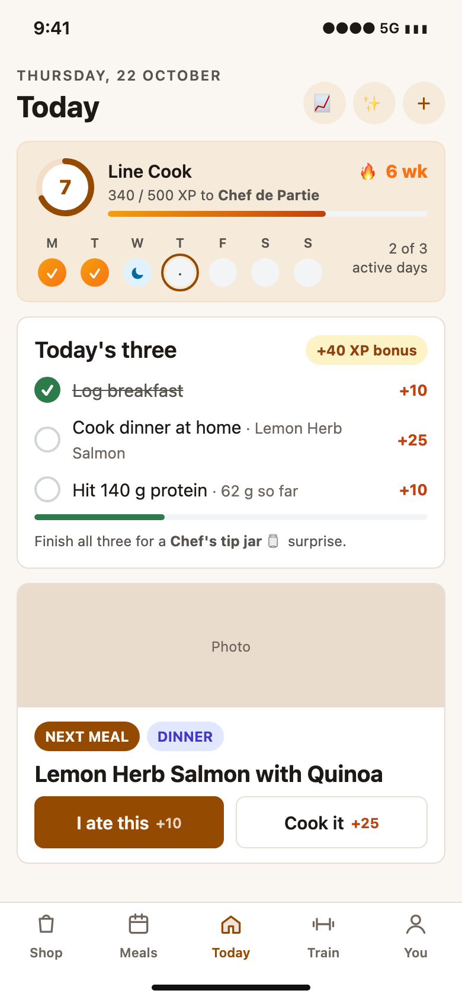 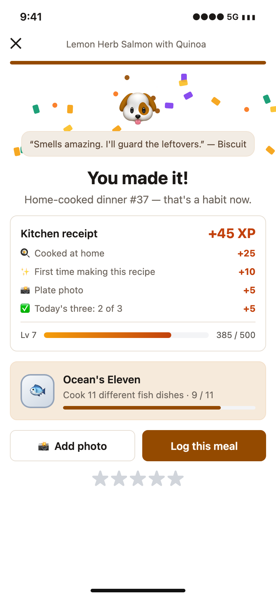 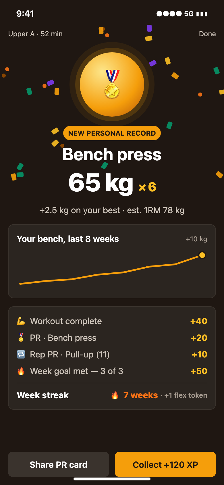 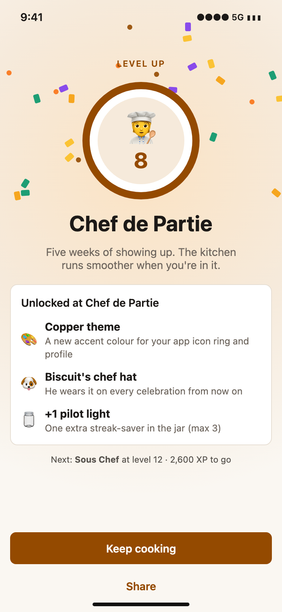 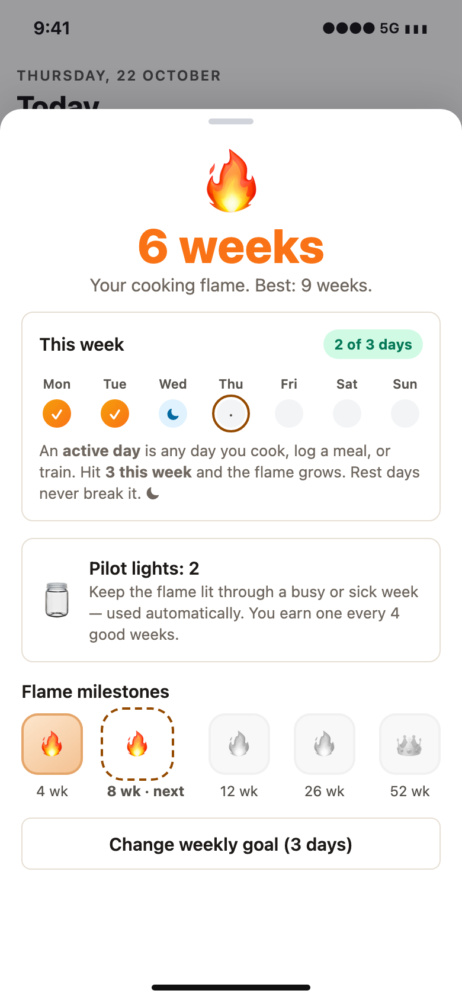 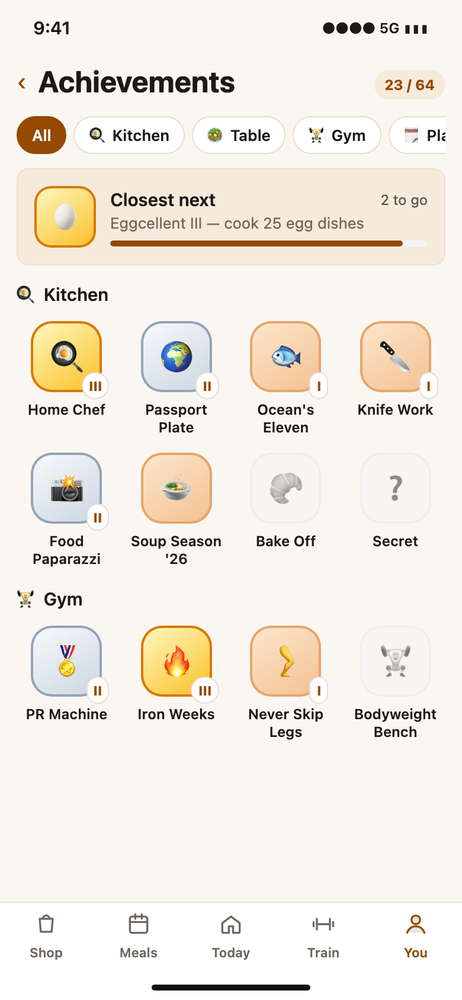 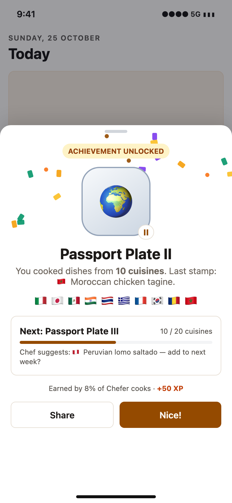 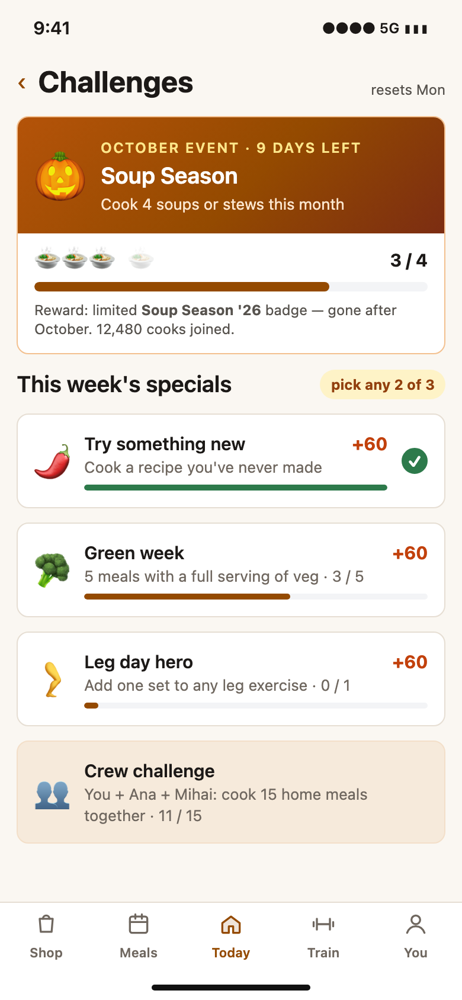 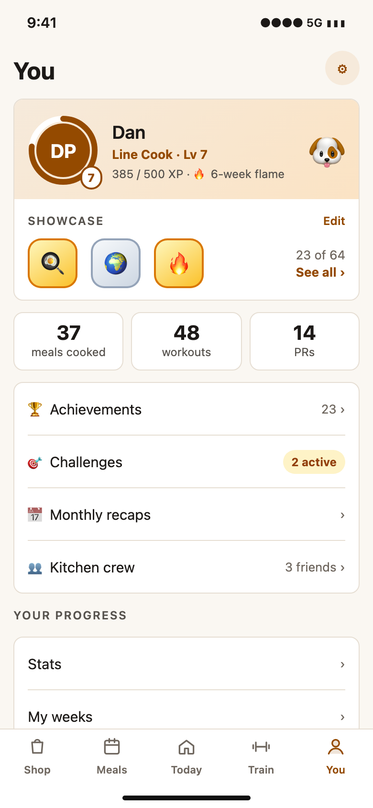 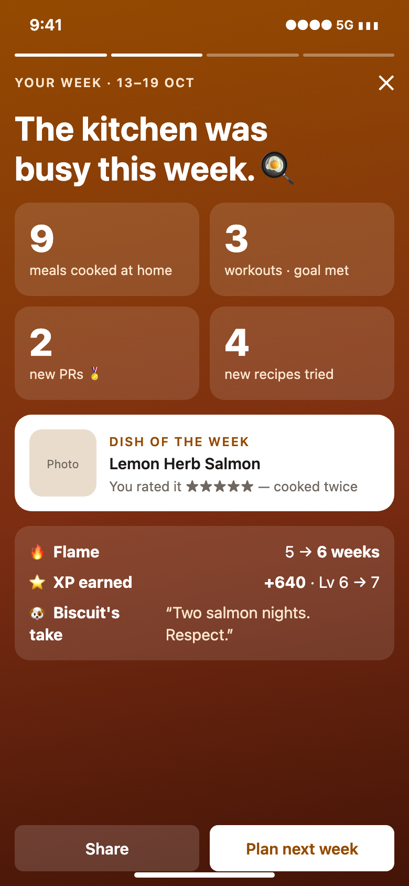 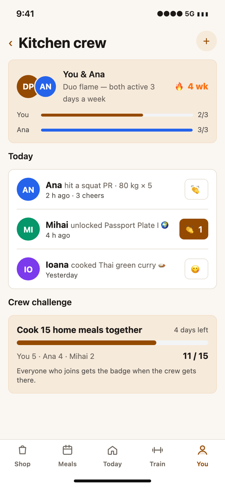 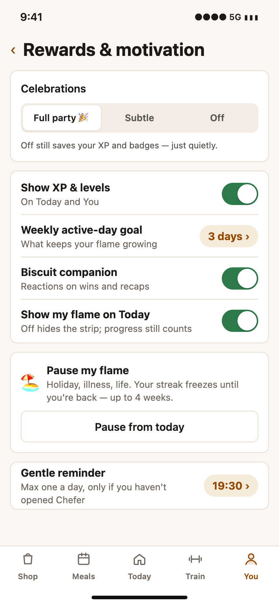 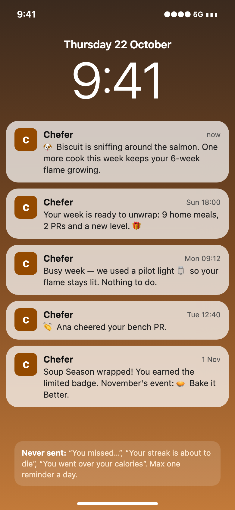

## 7. What we already have to build on

From origin/master, 2026-10-22:

- **Weekly training streak + flex tokens**: `packages/utils/src/gym/weeks.ts`. The Flame generalises it.
- **PR detection**: `packages/utils/src/gym/prs.ts` (`detectPrs`).
- **Confetti / tier-3 celebration**: `packages/ui-mobile/src/motion/celebration.tsx`. It already fires on day complete, shop done, workout with a PR or goal met, and cook finished (motion spec MO-07).
- **Biscuit the corgi**: `packages/utils/src/biscuit/` and `@chefer/ui-mobile` `Biscuit`, which already has a confetti loop.
- **Weekly review data and recaps**: `ChefReview`, the weekly email, the monthly gym recap.
- **Shame-free copy lint**: `no-forbidden-copy.js` and `wellness-copy.ts`.
- **Hook point for success moments**: `features/review/review-signals.ts`, which reads tRPC mutation callbacks.
- **Gaps:** a cook finish isn't stored on the server, and there is no generic activity or event log.

**Technical sketch (for later):**

- An append-only `ProgressEvent` ledger with an idempotency key (`kind + sourceId`).
- XP and achievement rules as pure functions in `@chefer/utils`, so the API, mobile and web share them.
- Server-authoritative totals. Offline workouts are scored when `upsertMany` syncs.
- A new `gamification` feature flag.
- New tRPC procedures under `progress.*`. They are additive, so shipped binaries are safe.
- Web shows the same strip, chef card and achievements (platform-parity rule).

## 8. Rollout

| Phase                      | What ships                                                                                                                                                  | Why first                                                                                  |
| -------------------------- | ----------------------------------------------------------------------------------------------------------------------------------------------------------- | ------------------------------------------------------------------------------------------ |
| **P1 — Core** (≈2–3 weeks) | Ideas 1–11, 13–15, 20–21, 28–31, 37–39, 44 (Biscuit cameo), 52, 56–59; 25 achievements; back-dated XP; mockups 01–06, 09, 10, 12                            | Progress bars and goals are what nutrition users value most, and they carry the least risk |
| **P2 — Delight**           | Tip jar, weekly specials, monthly events, relight, signature dish, passport, PR wall, Biscuit wardrobe (if wanted), cosmetics, cheers, share cards, Wrapped | Variety and surprise once the loop works                                                   |
| **P3 — Together**          | Duo flame, crew challenges, household co-op, trainer kudos, bingo, on this day                                                                              | Social carries the most risk; ship it after P1 data                                        |

**Measure:** D7/D30 retention, weeks with goal met per user, cook-mode completions, % of users who turn celebrations off (a pressure signal), and reminder opt-outs.

## 9. Owner decisions (answered 2026-10-22)

1. **Main streak:** the weekly Flame. ✅
2. **Default active-day goal:** **3 of 7**. Users can change it.
3. **Names:** keep Chef XP, Chef ranks, Flame, Pilot lights, Today's three.
4. **Biscuit:** left to us. **A light cameo in P1** (one line on big celebrations and the weekly recap, with an off switch). The wardrobe comes in P2 only if the dogfood shows people like him, since research rates mascots low in nutrition apps.
5. **Social leaderboard:** **not now.** Idea 49 is parked. Social stays cooperative: cheers, duo flame, crew challenges.
6. **Price:** free for everyone. Nothing is premium.
7. **Back-date XP:** yes. Existing users get XP and badges for their history at launch.
8. **Platforms:** web ships in the same release as mobile.

## 10. Sources

- **Duolingo:**
  - [Improving the streak](https://blog.duolingo.com/improving-the-streak) — 2.4×, +3.3% D14
  - [How streaks keep learners committed](https://blog.duolingo.com/how-streaks-keep-duolingo-learners-committed-to-their-language-goals) — Wager +14% D7, Weekend Amulet
  - [Friend streak](https://blog.duolingo.com/product-lessons-friend-streak/) — +22%
  - [Lenny's Newsletter: Duolingo growth](https://www.lennysnewsletter.com/p/how-duolingo-reignited-user-growth) — leagues +17%
  - [Behind the product: Duolingo streaks](https://www.lennysnewsletter.com/p/behind-the-product-duolingo-streaks)
- **Apple:**
  - [Ring pause, watchOS 11](https://9to5mac.com/2024/07/16/close-your-ringsbut-in-watchos-11-its-okay-if-you-dont/)
  - [Apple Watch 2026 activity data](https://www.apple.com/cm/newsroom/2026/01/apple-watch-keeps-users-active-and-motivated-in-2026)
- **Strava / Hevy / Fitbod / Peloton:**
  - [Strava streaks](https://support.strava.com/hc/en-us/articles/36553427481997-Streaks-on-Strava)
  - [Local Legends](https://dcrainmaker.com/2020/06/strava-legends-feature.html)
  - [Hevy weekly streak](https://help.hevyapp.com/hc/en-us/articles/34467766576279)
  - [Hevy live PR](https://help.hevyapp.com/hc/en-us/articles/36012016405655)
  - [Fitbod muscle recovery](https://help.fitbod.me/hc/en-us/articles/360006269014-Muscle-Recovery)
  - [Peloton milestones](https://www.pelobuddy.com/milestone-badges-updated/)
- **Spotify Wrapped 2025:** [MBW](https://www.musicbusinessworldwide.com/spotify-wrapped-campaign-hit-200m-engaged-users-in-24-hours-a-19-yoy-increase)
- **Khan Academy removing streaks:** [support post](https://support.khanacademy.org/hc/da/community/posts/360075847492/comments/360014049232)
- **Research:**
  - [Silverman & Barasch 2023, broken streaks](https://www.colorado.edu/business/faculty-research/2023/04/19/or-track-how-broken-streaks-affect-consumer-decisions)
  - [Sharif & Shu, emergency reserves](https://anderson-review.ucla.edu/emergency-reserves/)
  - [Lally et al., habit formation](https://www.ucl.ac.uk/news/2009/aug/how-long-does-it-take-form-habit)
  - [Dai, Milkman & Riis, fresh start](https://pubsonline.informs.org/doi/fpi/10.1287/mnsc.2014.1901)
  - [Kivetz et al., goal-gradient](https://business.columbia.edu/sites/default/files-efs/pubfiles/1200/goalgradient.pdf)
  - [Nunes & Drèze, endowed progress](https://coglode.com/nuggets/endowed-progress-effect)
  - [Deci, Koestner & Ryan 1999](https://depts.washington.edu/techdocs/papers/deciExtrinsicRewardsAndIntrinsicMotivation99.pdf)
  - [Mekler et al. 2017](https://edoc.unibas.ch/32047/)
  - [Berger & Jung 2024, nutrition-app gamification preferences](https://pmc.ncbi.nlm.nih.gov/articles/PMC11168059/)
  - [Althoff et al., Pokémon Go](https://arxiv.org/abs/1610.02085)
- **Diet-app harm:**
  - [Levinson et al. 2017](https://pubmed.ncbi.nlm.nih.gov/28843591/)
  - [Eikey 2021](https://www.cambridge.org/core/journals/bjpsych-open/article/effects-of-diet-and-fitness-apps-on-eating-disorder-behaviours-qualitative-study/2D1EE739D97AB3EFC6573835E4C527BD)
  - [Simpson & Mazzeo 2017](https://psychiatry.duke.edu/blog/trouble-tracking)
  - [Burke et al. 2011, self-monitoring](https://pubmed.ncbi.nlm.nih.gov/21185970/)
  - [MyFitnessPal: 4 days → 7×](https://athletechnews.com/nutrition-tracking-boosts-weight-loss-myfitnesspal-finds/)
